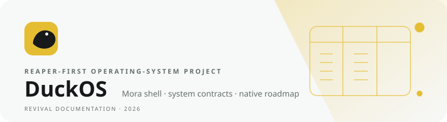
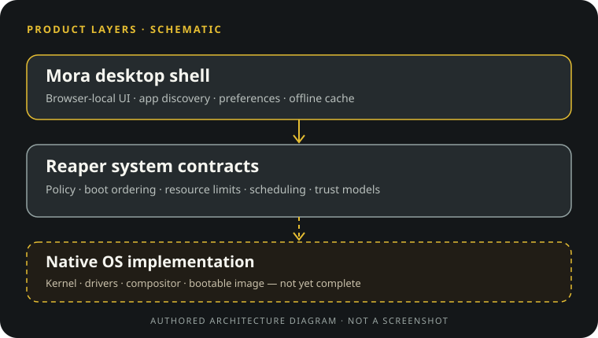
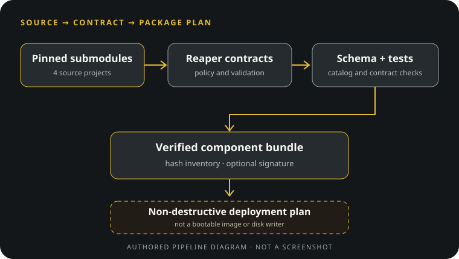

  <picture>
    <source media="(prefers-color-scheme: dark)" srcset="assets/readme/hero-banner-dark.svg">
    <source media="(prefers-color-scheme: light)" srcset="assets/readme/hero-banner-light.svg">
    
  </picture>

<h1 align="center">DuckOS</h1>

<strong>A Reaper-first operating-system project with a browser-local Mora desktop shell, versioned system contracts and a federated source workspace.</strong>

  
  

[Quick start](#quick-start) · [Revival update](#documentation-revival) · [Visual overview](#visual-overview) · [Architecture](#architecture-and-implementation-boundaries) · [Documentation](docs/README.md)

> **Implementation boundary:** Mora is currently a browser desktop shell. Reaper provides executable system-policy and boot/resource contracts on its reference runtime. These are not the same as a native kernel, driver stack, compositor, bootable image or production OS installation. The repository's implementation status is tracked in [docs/IMPLEMENTATION_STATUS.md](docs/IMPLEMENTATION_STATUS.md).

## Quick start

**Requirements:** Git, Node.js 18+ for JavaScript contract tests, and Python 3 for validation tools.

Clone the repository with its pinned source projects:

~~~sh
git clone --recurse-submodules https://github.com/Ivan-VHS/DuckOS.git
cd DuckOS
~~~

Run the repository checks:

~~~sh
npm test
python -m pip install jsonschema
python -m unittest discover -s tests -v
python tools/validate_app_catalog.py
~~~

Open the current Mora shell by opening <code>mora/index.html</code> in a modern browser. The shell has no external runtime dependencies; a secure browser context may be needed for Web Crypto file hashing.

To synchronize the already pinned submodule revisions in an existing checkout:

~~~sh
python tools/federate_repositories.py sync
~~~

This initializes the commits recorded by DuckOS. It does not update the submodules to their latest upstream revisions or overwrite local submodule changes.

## Documentation revival

| Before | Revival documentation |
|---|---|
| Static README entry point | Adaptive light/dark SVG hero with accessible fallback text |
| Product direction and implementation status were easy to conflate | Clear distinction between Mora browser shell, Reaper contracts and native OS work |
| No verified application screenshot in this repository | Two-column architecture visuals explicitly labelled as schematics, not screenshots |
| Build, test and deployment planning details were spread across pages | Quick start with separate validation and non-destructive packaging paths |
| Long documentation navigation | Updated document index, visual standard and contributor checklist |

This is a documentation refresh, **not a new DuckOS release or bootable image announcement**. No kernel, driver, compositor or installer capability is implied by the new visuals.

## Product and implementation overview

| Area | Current state | Boundary |
|---|---|---|
| Mora desktop | Browser-local unified shell, application discovery, preferences and offline cache | Not a native compositor or kernel service |
| First-party app catalog | Versioned catalog of application concepts and initial scopes | Catalog entries do not prove that apps ship in a bootable image |
| Reaper system contracts | Executable policy/reference contracts for startup ordering, resource limits, scheduling, trust and data flow | Does not itself supply native privileged execution |
| Source federation | Four independent, commit-pinned specialist repositories | Imported sources are not automatically built, launched or loaded as drivers |
| Release packaging | Deterministic component bundle, SHA-256 inventory and optional Ed25519 signing/verification | Does not create a bootable ISO/USB image |
| Deployment planning | Non-destructive GPT layout and USB/PXE/UEFI HTTP Boot/iPXE/cloud plan descriptions | Does not write physical disks or deploy a running OS |
| Native OS implementation | Architecture and contracts under active development | Native kernel, full driver runtime, boot path, compositor and recovery still require implementation |

## Visual overview

<em>No verified live desktop screenshot is committed in this repository. The following are authored architecture illustrations, not application captures.</em>

<table>
  <tr>
    <td width="50%">
      
      
<strong>Product layers — schematic.</strong> The native OS layer is shown as incomplete work, not as a running system.

    </td>
    <td width="50%">
      
      
<strong>Repository and release pipeline — schematic.</strong> A deployment plan is not a bootable image.

    </td>
  </tr>
</table>

## Architecture and implementation boundaries

~~~mermaid
flowchart LR
  A[DuckOS repository] --> B[Commit-pinned source federation]
  B --> C[Reaper reference contracts]
  C --> D[Policy and contract validation]
  D --> E[Versioned manifests and schemas]
  E --> F[Verified component bundle]
  F --> G[Non-destructive deployment plan]
  A --> H[Mora browser desktop shell]
  C -. future native backend .-> I[Kernel / drivers / native compositor]
~~~

The dashed native branch is a future implementation boundary, not a claim of present kernel or driver execution. For the authoritative layer description, see [Architecture](docs/ARCHITECTURE.md), [Build contracts](docs/BUILD_CONTRACTS.md) and [Implementation status](docs/IMPLEMENTATION_STATUS.md).

## Federated source workspace

DuckOS keeps four specialist projects as independent commit-pinned Git submodules under <code>projects/</code>:

- [Reaper](https://github.com/Ivan-VHS/Reaper) — source-language semantics and system-policy contracts.
- [Pytyliki](https://github.com/Ivan-VHS/Pytyliki) — processor systems and bounded hardware diagnostics.
- [OPlague](https://github.com/Ivan-VHS/OPlague) — read-only device and driver evidence workbench.
- [VentuSample](https://github.com/Ivan-VHS/VentuSample) — offline procedural audio and DSP workstation.

The pinned checkouts are source dependencies, not automatically built OS services. The explicit Reaper workbench integration can run approved checks and launch Studio; it does not grant kernel or device privileges. See [Repository federation](docs/REPOSITORY_FEDERATION.md) and [Reaper integration](docs/REAPER_INTEGRATION.md).

## Reaper workbench

After initializing the pinned Reaper submodule, the DuckOS CLI exposes these integration commands:

~~~sh
duckos reaper status
duckos reaper studio
duckos reaper check ./examples/program.rpr
duckos reaper typecheck ./examples/program.rpr
~~~

These commands operate the documented developer-workbench integration; they do not boot DuckOS or execute kernel code.

## Release packaging and deployment planning

Validate a local system manifest and staged root filesystem:

~~~sh
python -m duckos validate-manifest system-manifest.json build/rootfs
~~~

Build a component archive:

~~~sh
python -m duckos build-release system-manifest.json build/rootfs DuckOS-release.tar.gz
~~~

Create a non-destructive USB layout plan:

~~~sh
python -m duckos deployment-plan system-manifest.json build/rootfs --target usb --output usb-layout.json
~~~

The toolchain can create and verify component archives, checksums and optional signatures, and describe deployment layouts. It does **not** yet produce a bootable ISO/USB image, write a physical disk, install firmware Secure Boot keys, or implement native boot rollback. Read [Deployment tooling](docs/DEPLOYMENT.md) before treating a plan as an installation procedure.

## Configuration

The browser shell does not require a root <code>.env</code>, hosted account, API token or remote backend for its local workflow. System and application policy contracts are versioned in repository files such as <code>mora/system-policy.json</code> and the files linked from the [documentation index](docs/README.md). Do not add placeholder credentials or undocumented environment variables to this README.

## Repository map

| Path | Responsibility |
|---|---|
| <code>mora/</code> | Current Mora browser desktop shell, theme and local system-policy files |
| <code>prototype/</code> | Earlier Mora prototype retained for reference |
| <code>projects/</code> | Commit-pinned specialist source repositories |
| <code>duckos/</code> | DuckOS language-level contracts and security policy |
| <code>catalogs/</code> and <code>schemas/</code> | Versioned application, system and transfer contracts |
| <code>tools/</code> | Federation, validation, release packaging and deployment planning |
| <code>tests/</code> | Python and JavaScript contract/regression tests |
| <code>docs/</code> | Architecture, implementation status, deployment and integration documentation |
| <code>.github/workflows/</code> | CI, completeness, compatibility and federation checks |

## Verification and roadmap

~~~sh
npm test
python -m unittest discover -s tests -v
python tools/validate_app_catalog.py
git diff --check
~~~

Use [Implementation status](docs/IMPLEMENTATION_STATUS.md) for the current maturity ledger, [Deployment](docs/DEPLOYMENT.md) for archive and plan capabilities, and [Windows compatibility](docs/WINDOWS_COMPATIBILITY.md) for the executable-inspection boundary. A passing contract test is not proof of native kernel, device-driver or boot-image behavior.

## Contributing and security

Read [CONTRIBUTING.md](CONTRIBUTING.md) before changing system contracts, manifests, federation or native boundaries. The documentation publication rules are in [README Visual Standard](docs/README_VISUAL_STANDARD.md); use the repository's existing security and capability contracts when reviewing changes.

## Further reading

- [Mora desktop integration](docs/MORA_INTEGRATION.md)
- [Preinstalled application specification](docs/PREINSTALLED_APPLICATIONS.md)
- [DuckOS Extended Terminal](docs/EXTENDED_TERMINAL.md)
- [DuckOS architecture](docs/ARCHITECTURE.md)
- [Build contracts](docs/BUILD_CONTRACTS.md)
- [Deployment tooling](docs/DEPLOYMENT.md)
