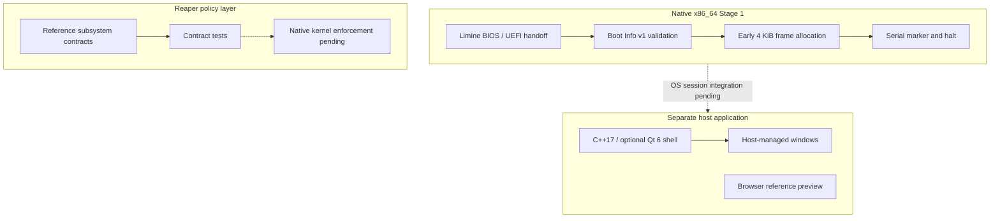

# DAK — Reaper-first operating-system project

[English](README.md) · [Українська](README.uk.md) · [Русский](README.ru.md) · [简体中文](README.zh-CN.md)

> Experimental x86_64 system foundation: a QEMU-verified Stage 1 boot path, Reaper policy contracts and a separate host-native desktop shell.

**Specification**

| Field | Current record |
|---|---|
| Repository | [Ivan-VHS/DAK](https://github.com/Ivan-VHS/DAK) |
| Project status | Experimental; Stage 1 foundation |
| Product version | No unified DAK release version declared |
| Native boot target | x86_64, Linux build host, Limine BIOS/UEFI image |
| Policy language | Reaper; reference contracts, native enforcement incomplete |
| Boot bridge | C11 freestanding platform boundary |
| Host desktop | C++17 / optional Qt 6 Widgets 6.4+ |
| Tooling | CMake 3.21+, Python 3.10+, Node.js 22+ |
| License | No root LICENSE file; redistribution terms are not declared |
| Last documentation review | 2026-11-26 |

<p align="center"></p>

## Contents

- [Purpose and scope](#purpose-and-scope)
- [Architecture](#architecture-and-data-flow)
- [Current implementation](#implementation-status)
- [Build and verification](#build-and-verification)
- [Interfaces and ecosystem](#interfaces-and-ecosystem)
- [Limitations and trust boundaries](#limitations-and-trust-boundaries)
- [Documentation and governance](#documentation-and-governance)
- [History and licensing](#history-and-licensing)

## Purpose and scope

DAK is an experimental operating-system project with three distinct execution surfaces: a freestanding x86_64 Stage 1 kernel foundation, Reaper reference policy contracts, and a host-native desktop prototype. They are not yet one integrated operating-system session.

The current boot path validates the firmware handoff and Boot Info v1, allocates and clears one early 4 KiB physical frame, prints a serial success marker and halts. The desktop shell runs as an application on the host OS; it is not started by the kernel.

## Architecture and data flow



The native boot bridge is deliberately narrow. Reaper owns the policy/reference layer; host tools and companion applications remain separate processes and repositories until the kernel has process, syscall, filesystem and capability enforcement.

## Implementation status

| Capability | Maturity | Evidence boundary |
|---|---|---|
| Limine handoff and Boot Info v1 validation | Verified at Stage 1 | BIOS and UEFI QEMU checks |
| Early physical-frame allocation | Implemented at Stage 1 | One 4 KiB frame; monotonic, no free path |
| CPU exception IDT | Partial / QEMU marker verified | Vectors 0–31; not full interrupt routing |
| Reaper subsystem policies | Implemented as reference contracts | Tests do not imply kernel enforcement |
| Host-native desktop shell | Partial | Qt application; independent host windows |
| Browser desktop preview | Reference implementation | Not a native compositor |
| Process model, syscall ABI, virtual memory | Planned | No user process session |
| Filesystem, service supervisor, package manager, installer | Planned | No kernel service lifecycle |
| Driver runtime, GPU compositor, audio stack | Planned | No physical device control |

The authoritative capability ledger is [Implementation Status](docs/IMPLEMENTATION_STATUS.md). The [project evolution ladder](docs/PROJECT_EVOLUTION_LADDER.md) defines evidence gates; stage names are not release certification.

## Build and verification

### Host contract tests

Requirements: CMake 3.21+ and a C11 compiler.

```sh
cmake -S . -B build -DCMAKE_BUILD_TYPE=Debug -DBUILD_TESTING=ON
cmake --build build --parallel
ctest --test-dir build --output-on-failure
```

### Stage 1 boot image

Build on Linux x86_64 with GCC/binutils, Git, curl, tar, xorriso and sha256sum available:

```sh
boot/build-iso.sh --work-dir build/dak-boot --output dist/DAK-Stage1-x86_64.iso
```

QEMU BIOS/UEFI verification and serial-log requirements are documented in [Bootable Image](docs/BOOTABLE_IMAGE.md). A successful Stage 1 boot is not a usable OS session.

### Optional host desktop and browser preview

The Qt 6 host shell is optional and requires a C++17 compiler plus Qt 6 Widgets 6.4 or newer:

```sh
cmake -S . -B build/desktop -DDAK_BUILD_NATIVE_DESKTOP=ON
cmake --build build/desktop --parallel
```

The browser reference surface has its own Node test suite:

```sh
npm test
```

The current package manifest requires Node.js 18+, while the maintained contributor/CI workflow uses Node.js 22+. None of these host commands boots the kernel into a desktop session.

## Interfaces and ecosystem

- [Boot Info v1](docs/BOOT_INFO_V1.md) — firmware handoff data and validation boundary.
- [Core subsystem MVP](docs/CORE_MVP_V1.md) — Reaper reference contracts and native-enforcement status.
- [Ecosystem integration](docs/ECOSYSTEM_INTEGRATION.md) — pinned peer repositories and versioned interchange.
- [Release edition](docs/RELEASE_EDITION.md) — source/tool packaging boundary; not an installable OS release.

Peer projects retain their own repositories, licenses and release cycles: [Reaper](https://github.com/Ivan-VHS/Reaper), [Pytyliki](https://github.com/Ivan-VHS/Pytyliki), [OPlague](https://github.com/Ivan-VHS/OPlague), and [VentuSample](https://github.com/Ivan-VHS/VentuSample). A submodule pin or host binary is not kernel integration.

## Limitations and trust boundaries

> **Important:** DAK is not yet a general-purpose, installable operating system. Stage 1 halts after boot validation and early frame allocation.

Page tables, reusable memory management, process isolation, syscall dispatch, preemptive scheduling, filesystem access, service supervision, kernel-enforced capabilities, production driver loading and a native compositor are not complete. The current Reaper-native compiler is not yet a freestanding kernel compiler.

Hardware, firmware, driver and package operations remain unimplemented or reference-only unless a specific reviewed contract says otherwise. A caller-supplied “signature verified” field is not cryptographic verification. SHA-256 checksums detect byte changes but do not authenticate a publisher.

The repository has no root LICENSE or SECURITY.md as reviewed on 2026-11-26. Do not assume redistribution rights or interpret the absence of a security policy as a security guarantee. See [Contributing](CONTRIBUTING.md) and the [documentation control policy](docs/DOCUMENTATION_CONTROL.md).

## Documentation and governance

Start at [Documentation Index](docs/README.md) and [Information Architecture](docs/INFORMATION_ARCHITECTURE.md). The implementation-status ledger, boot guide, architecture and versioned schemas are the primary technical references.

- [Architecture](docs/ARCHITECTURE.md)
- [Implementation status](docs/IMPLEMENTATION_STATUS.md)
- [Bootable Stage 1 image](docs/BOOTABLE_IMAGE.md)
- [Build contracts](docs/BUILD_CONTRACTS.md)
- [Unified documentation standard](docs/UNIFIED_DOCUMENTATION_STANDARD.md)
- [Documentation rebaseline plan](docs/superpowers/plans/2026-11-26-documentation-rebaseline.md)

## History and licensing

The current repository records an experimental Stage 1 boot milestone and separate host-desktop work. There is no unified semantic-version release history declared for DAK; component package versions must not be mistaken for a DAK OS release. Exact build evidence and source revisions belong in the implementation ledger and release artifacts.

Third-party bootloader and peer-project notices remain governed by their own upstream licenses. The release packaging workflow carries notices and source pins; it does not grant additional redistribution rights. A root project license must be selected by the rights holder before distribution terms can be stated.
