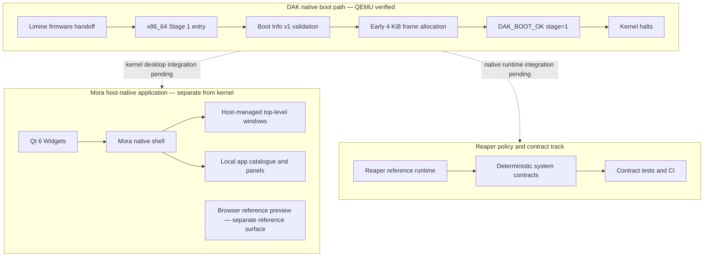

# DAK

**A Reaper-first operating-system project with a local-first desktop shell and a federated native-tooling ecosystem.**

**Project evolution:** [10-rung ladder](docs/PROJECT_EVOLUTION_LADDER.md) · [Current rung record](.github/project-ladder.v1.json)

<p align="center">
  
</p>

<p align="center">
  <a href="docs/IMPLEMENTATION_STATUS.md">Mora native shell status</a> · <a href="mora/index.html">Browser preview</a> ·
  <a href="docs/RELEASE_EDITION.md">Release edition</a> ·
  <a href="docs/ARCHITECTURE.md">Architecture</a> ·
  <a href="docs/IMPLEMENTATION_STATUS.md">Implementation status</a> ·
  <a href="docs/IMPLEMENTATION_ROADMAP.md">Roadmap</a> ·
  <a href="docs/CORE_MVP_V1.md">Core subsystem MVP</a>
</p>

> **Current release boundary:** DAK has an experimental x86_64 Stage 1 kernel image that passes QEMU BIOS and UEFI boot checks. The kernel validates the firmware handoff, allocates and clears an early 4 KiB frame, emits `DAK_BOOT_OK stage=1`, and halts. Mora now has a host-native Qt 6 Widgets desktop application and a retained browser reference preview; neither is started by this Stage 1 kernel.

## System map

The three implementation tracks are deliberately shown separately. A policy contract, host application and bootable kernel stage are different kinds of evidence.



## What is included

| Area | Present today | Boundary |
|---|---|---|
| **Mora desktop** | Qt 6 Widgets host-native shell, host-managed top-level windows, local app catalogue, Poi drafts, user-selected read-only file listing, plus browser reference preview | Native to the host OS; not yet launched inside a DAK user session or kernel compositor |
| **Reaper policy layer** | Startup, memory-range, scheduling, bounded IPC, capabilities, service-restart and other deterministic reference contracts | Reference-runtime policy; not yet a privileged native kernel runtime |
| **Core subsystem MVP** | 40 additional Reaper contracts for process, VM, VFS, network, graphics, audio, MAC, architecture/device, init and accessibility policy; tree-walk and VM contract suite | Policy validation only; no implicit process creation, page mapping, filesystem driver, network stack or hardware enforcement |
| **x86_64 boot foundation** | Limine handoff, Boot Info v1 validation, early monotonic physical-frame allocation and serial boot marker | Stage 1 only; no process or service session |
| **Ecosystem payload** | Pinned source, documentation, schemas, licenses, Mora assets and tested host tools | Host tools are not DAK kernel executables |
| **Release pipeline** | Source-pin validation, project builds/tests, SHA-256 inventory, hybrid BIOS/UEFI ISO and QEMU boot checks | Preview source-and-tools distribution, not a complete installable OS |

## Federated workbenches

The four repositories below are pinned by exact Git commits in `federation/repositories.v1.json`. Their source trees and license notices remain attributable to their own projects.

| Project | Role in the ecosystem | Native foundation |
|---|---|---|
| [Reaper](https://github.com/Ivan-VHS/Reaper) | Language, compiler tooling and system-policy contracts | C17 native track plus reference runtime |
| [Pytyliki](https://github.com/Ivan-VHS/Pytyliki) | Processor inspection, bounded analysis and profiling | C11 core, CLI and Windows desktop |
| [OPlague](https://github.com/Ivan-VHS/OPlague) | Read-only device/driver evidence and compatibility workbench | Local user-space inspection tools |
| [VentuSample](https://github.com/Ivan-VHS/VentuSample) | Procedural samples and offline audio processing | C++20 core and optional Qt 6 desktop |

Mora workbench panels provide local documentation, descriptions and build/test guidance. The native shell does not execute manifest command strings or grant hardware privileges. The browser version is retained only as a reference preview.

## Build and run native Mora

Mora's native host application uses Qt 6 Widgets. App windows are separate top-level host windows managed by Windows, Linux or another supported host desktop. It does not embed a browser engine, WebView or HTML application surface.

**Linux**
```sh
cmake -S . -B build/mora-native -DCMAKE_BUILD_TYPE=Release -DDAK_BUILD_NATIVE_MORA=ON
cmake --build build/mora-native --target dak_mora_native --parallel
./build/mora-native/dak_mora_native
```

**Windows PowerShell** (with Qt 6 Widgets and its CMake package configured)
```powershell
cmake -S . -B build/mora-native -A x64 -DDAK_BUILD_NATIVE_MORA=ON
cmake --build build/mora-native --config Release --target dak_mora_native
.\build\mora-native\Release\dak_mora_native.exe
```

The optional target is skipped when Qt 6 Widgets is not found. Its native shell smoke test runs through CTest in the dedicated Mora native desktop workflow. mora/apps.json is the local catalogue source; app entries do not execute commands. Poi stores drafts in host-local application settings, Abriganza lists metadata only after a folder is selected, and the VentuSample waveform remains a visual preview until an audio engine is connected.

## Browser reference preview

The previous browser shell is retained for reference only. To open it, run ./scripts/run-mora.sh on Linux or .\scripts\run-mora.ps1 on Windows. The local server binds to 127.0.0.1.

Run the browser-shell contract suite with Node.js 22+:

```sh
npm test
```

## Build the release ISO

The reproducible release pipeline targets Linux x86_64 and expects Git/submodules, GCC/G++, CMake, Python 3, Node.js 22, Qt 6 Widgets, xorriso, curl, tar, QEMU and OVMF.

```sh
git clone --recurse-submodules https://github.com/Ivan-VHS/DAK.git
cd DAK
bash boot/build-release-iso.sh --work-dir build/release --output dist/DAK-Release-x86_64.iso
```

The pipeline validates repository pins, tests Mora, builds/tests the Reaper and Pytyliki host tools, builds/tests VentuSample, verifies OPlague source and tests, packages source and license notices, checks the SHA-256 inventory, and produces a hybrid BIOS/UEFI ISO. GitHub Actions runs the release pipeline and QEMU boot gates.

The ISO is content-sized. It is not padded to 4 GiB: empty bytes would only increase download size without adding a filesystem, application or operating-system capability. See [Release edition](docs/RELEASE_EDITION.md) for exact payload contents and commands.

## Kernel status and next layers

| Layer | Status |
|---|---|
| Limine firmware handoff and Boot Info v1 validation | Implemented and QEMU-verified |
| Early physical-frame allocation | Implemented for the Stage 1 boot path |
| Reaper core subsystem MVP (40 contracts) | Implemented on the reference runtime; native enforcement pending |
| Reusable memory manager, page tables and address spaces | Pending |
| Interrupts, timers, preemptive scheduler and process model | Pending |
| Syscall ABI, kernel-enforced capabilities and zero-copy IPC | Pending |
| PCI/USB/ACPI discovery and isolated driver runtime | Pending |
| Filesystem, service supervisor, installer and persistent user session | Pending |
| Native compositor, GPU and audio stack | Pending |
| Freestanding native Reaper compiler/backend | Pending |

There is no claim of physical-hardware qualification, Secure Boot support, a disk installer, a native Mora compositor, a general process model or kernel-enforced sandboxing. See [Implementation status](docs/IMPLEMENTATION_STATUS.md), [Core subsystem MVP](docs/CORE_MVP_V1.md) and [Architecture](docs/ARCHITECTURE.md) for the detailed evidence ledger.

## Architecture targets

DAK now records **x86_64 as the primary target for Intel and AMD**. The architecture policy retains **Elbrus as a compatibility-preserved track**; this recognition does not claim that an Elbrus compiler backend, boot image or physical-hardware test matrix is already available. The x86_64 target is vendor-neutral and does not split Intel and AMD into incompatible code paths.

## Source federation and integrity

The active source set is defined in `federation/repositories.v1.json`. Initialize the exact pinned sources with:

```sh
git submodule update --init --recursive
```

The pre-release DAK repository snapshot is preserved on `archive/pre-release-snapshot-2026-11-25`. That branch preserves this repository's Git state; it does not recreate the histories of external repositories.

## Engineering rule

Describe behavior from source, tests, schemas, build output and CI evidence. A catalogue or roadmap is not proof of implementation. Browser preferences are not kernel enforcement; PE inspection is not process execution; a checksum is not proof of authorship.
