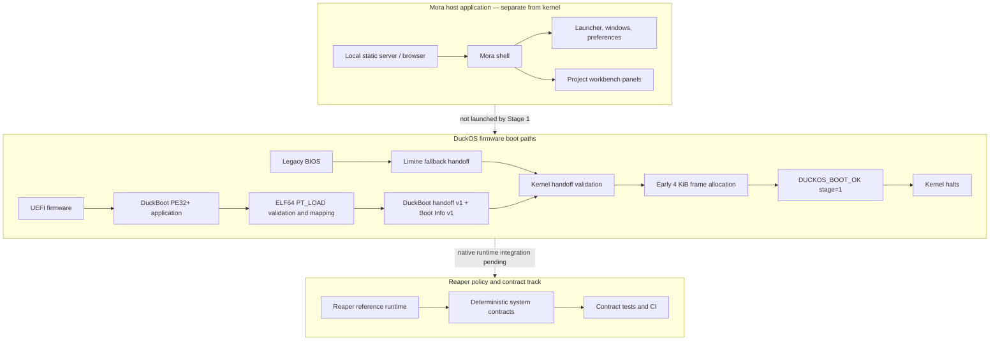

# DuckOS

**A Reaper-first operating-system project with a local-first desktop shell and a federated native-tooling ecosystem.**

<p align="center">
  
</p>

<p align="center">
  <a href="mora/index.html">Open Mora</a> ·
  <a href="docs/RELEASE_EDITION.md">Release edition</a> ·
  <a href="docs/ARCHITECTURE.md">Architecture</a> ·
  <a href="docs/IMPLEMENTATION_STATUS.md">Implementation status</a> ·
  <a href="docs/DUCKBOOT_CORE.md">DuckBoot Core</a> ·
  <a href="docs/IMPLEMENTATION_ROADMAP.md">Roadmap</a> ·
  <a href="docs/CORE_MVP_V1.md">Core subsystem MVP</a>
</p>

> **Current release boundary:** The main-branch image retains the QEMU-verified Limine Stage 1 path. This feature branch adds a first-party x86-64 UEFI application, ELF64 loading and a DuckBoot kernel handoff; both BIOS fallback and the native DuckBoot UEFI handoff now pass the GitHub Actions QEMU/OVMF gate. Legacy BIOS remains on Limine until a native DuckBoot BIOS stage exists. Mora is a separate host-browser application, not a kernel desktop.

## System map

The three implementation tracks are deliberately shown separately. A policy contract, host application and bootable kernel stage are different kinds of evidence.



## What is included

| Area | Present today | Boundary |
|---|---|---|
| **Mora desktop shell** | Responsive local browser workspace, launcher, interactive windows, dock, local preferences, reduced-motion mode, local app data and scoped offline cache | Runs on the host browser; not a native kernel compositor |
| **Reaper policy layer** | Startup, memory-range, scheduling, bounded IPC, capabilities, service-restart and other deterministic reference contracts | Reference-runtime policy; not yet a privileged native kernel runtime |
| **Core subsystem MVP** | 40 additional Reaper contracts for process, VM, VFS, network, graphics, audio, MAC, architecture/device, init and accessibility policy; tree-walk and VM contract suite | Policy validation only; no implicit process creation, page mapping, filesystem driver, network stack or hardware enforcement |
| **x86_64 boot foundation** | BIOS Limine fallback, Boot Info v1 validation, early monotonic physical-frame allocation and serial boot marker | Stage 1 only; no process or service session |
| **DuckBoot Core** | Host-tested BootArena/config/ELF64 contracts; UEFI PE32+ loader, kernel segment mapping and versioned handoff producer/consumer | QEMU BIOS fallback and DuckBoot UEFI/OVMF handoff verified; BIOS still uses Limine |
| **Ecosystem payload** | Pinned source, documentation, schemas, licenses, Mora assets and tested host tools | Host tools are not DuckOS kernel executables |
| **Release pipeline** | Source-pin validation, project builds/tests, SHA-256 inventory, hybrid BIOS/UEFI ISO and QEMU boot checks | Preview source-and-tools distribution, not a complete installable OS |

## Federated workbenches

The four repositories below are pinned by exact Git commits in `federation/repositories.v1.json`. Their source trees and license notices remain attributable to their own projects.

| Project | Role in the ecosystem | Native foundation |
|---|---|---|
| [Reaper](https://github.com/Ivan-VHS/Reaper) | Language, compiler tooling and system-policy contracts | C17 native track plus reference runtime |
| [Pytyliki](https://github.com/Ivan-VHS/Pytyliki) | Processor inspection, bounded analysis and profiling | C11 core, CLI and Windows desktop |
| [OPlague](https://github.com/Ivan-VHS/OPlague) | Read-only device/driver evidence and compatibility workbench | Local user-space inspection tools |
| [VentuSample](https://github.com/Ivan-VHS/VentuSample) | Procedural samples and offline audio processing | C++20 core and optional Qt 6 desktop |

Mora workbench panels provide local documentation, descriptions and build/test guidance. Browser code does not execute external commands or grant hardware privileges.

## Open Mora

For a browser preview, open `mora/index.html`. For offline assets and the bundled project documentation, run the local server.

**Linux**
```sh
./scripts/run-mora.sh
```

**Windows PowerShell**
```powershell
.\scripts\run-mora.ps1
```

The server binds to `127.0.0.1`. Keep its terminal open while Mora is in use. No cloud service or external CDN is required for the shell itself.

Run the Mora contract suite with Node.js 22+:

```sh
npm test
```

## Build the release ISO

The reproducible release pipeline targets Linux x86_64 and expects Git/submodules, GCC/G++, Clang/lld-link, dosfstools/mtools, CMake, Python 3, Node.js 22, Qt 6 Widgets, xorriso, curl, tar, QEMU and OVMF.

```sh
git clone --recurse-submodules https://github.com/Ivan-VHS/DuckOS.git
cd DuckOS
bash boot/build-release-iso.sh --work-dir build/release --output dist/DuckOS-Release-x86_64.iso
```

The pipeline validates repository pins, tests Mora, builds/tests the Reaper and Pytyliki host tools, builds/tests VentuSample, verifies OPlague source and tests, packages source and license notices, checks the SHA-256 inventory, and produces a hybrid BIOS/UEFI ISO. GitHub Actions runs the release pipeline and QEMU boot gates.

The ISO is content-sized. It is not padded to 4 GiB: empty bytes would only increase download size without adding a filesystem, application or operating-system capability. See [Release edition](docs/RELEASE_EDITION.md) for exact payload contents and commands.

## Kernel status and next layers

| Layer | Status |
|---|---|
| Limine BIOS fallback and Boot Info v1 validation | Implemented and QEMU-verified |
| DuckBoot UEFI application, ELF64 loader and handoff v1 | Implemented in feature branch; QEMU/OVMF handoff verified |
| Early physical-frame allocation | Implemented for the Stage 1 boot path |
| Reaper core subsystem MVP (40 contracts) | Implemented on the reference runtime; native enforcement pending |
| Reusable memory manager, page tables and address spaces | Pending |
| Interrupts, timers, preemptive scheduler and process model | Pending |
| Syscall ABI, kernel-enforced capabilities and zero-copy IPC | Pending |
| PCI/USB/ACPI discovery and isolated driver runtime | Pending |
| Filesystem, service supervisor, installer and persistent user session | Pending |
| Native compositor, GPU and audio stack | Pending |
| Freestanding native Reaper compiler/backend | Pending |

There is no claim of physical-hardware qualification, Secure Boot support, a disk installer, a native Mora compositor, a general process model or kernel-enforced sandboxing. See [Implementation status](docs/IMPLEMENTATION_STATUS.md), [Core subsystem MVP](docs/CORE_MVP_V1.md) and [Architecture](docs/ARCHITECTURE.md) for the detailed evidence ledger.

## Architecture targets

DuckOS now records **x86_64 as the primary target for Intel and AMD**. The architecture policy retains **Elbrus as a compatibility-preserved track**; this recognition does not claim that an Elbrus compiler backend, boot image or physical-hardware test matrix is already available. The x86_64 target is vendor-neutral and does not split Intel and AMD into incompatible code paths.

## Source federation and integrity

The active source set is defined in `federation/repositories.v1.json`. Initialize the exact pinned sources with:

```sh
git submodule update --init --recursive
```

The pre-release DuckOS repository snapshot is preserved on `archive/pre-release-snapshot-2026-11-25`. That branch preserves this repository's Git state; it does not recreate the histories of external repositories.

## Engineering rule

Describe behavior from source, tests, schemas, build output and CI evidence. A catalogue or roadmap is not proof of implementation. Browser preferences are not kernel enforcement; PE inspection is not process execution; a checksum is not proof of authorship.
