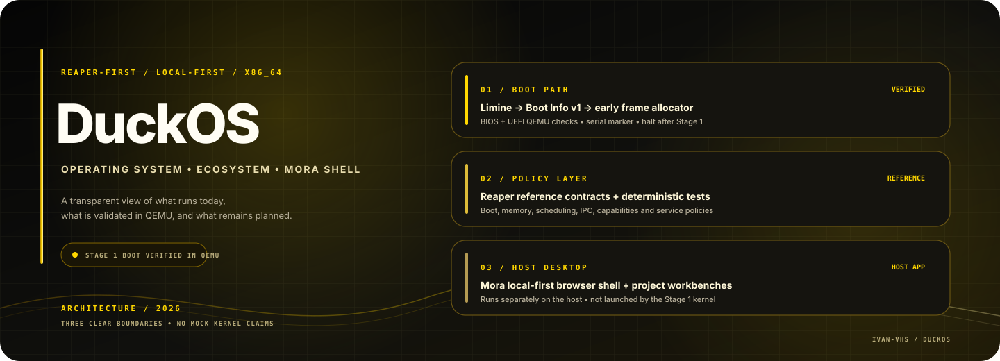
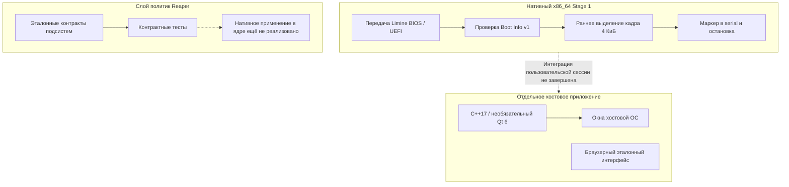

# DAK — проект операционной системы на основе Reaper

[English](README.md) · [Українська](README.uk.md) · [Русский](README.ru.md) · [简体中文](README.zh-CN.md)

> Экспериментальная системная основа x86_64: загрузка Stage 1, проверенная в QEMU, контракты политик Reaper и отдельная настольная оболочка, работающая в хостовой ОС.

**Спецификация**

| Поле | Текущее состояние |
|---|---|
| Репозиторий | [Ivan-VHS/DAK](https://github.com/Ivan-VHS/DAK) |
| Статус проекта | Экспериментальная разработка; основа Stage 1 |
| Версия продукта | Единая версия выпуска DAK не объявлена |
| Целевая архитектура загрузки | x86_64; сборка образа на Linux; BIOS/UEFI через Limine |
| Язык политик | Reaper; эталонные контракты, нативное применение ещё не завершено |
| Загрузочный мост | Узкая freestanding-граница на C11 |
| Хостовая оболочка | C++17 / необязательный Qt 6 Widgets 6.4+ |
| Инструменты | CMake 3.21+, Python 3.10+, Node.js 22+ |
| Лицензия | Корневой LICENSE отсутствует; условия распространения не объявлены |
| Кодекс поведения | Отдельный `CODE_OF_CONDUCT.md` не опубликован |
| Дата проверки документации | 2026-11-26 |

<p align="center"></p>

## Содержание

- [Назначение и область проекта](#назначение-и-область-проекта)
- [Архитектура](#архитектура-и-поток-данных)
- [Состояние реализации](#состояние-реализации)
- [Сборка и проверка](#сборка-и-проверка)
- [Интерфейсы и экосистема](#интерфейсы-и-экосистема)
- [Ограничения и границы доверия](#ограничения-и-границы-доверия)
- [Документация](#документация-и-управление)
- [История и лицензирование](#история-и-лицензирование)

## Назначение и область проекта

DAK — экспериментальный проект операционной системы с тремя раздельными исполнительными поверхностями: freestanding-основа ядра x86_64 Stage 1, эталонные контракты политик Reaper и прототип настольного приложения, работающего в хостовой ОС. Пока это не единая интегрированная пользовательская сессия операционной системы.

Текущий путь загрузки проверяет передачу управления от прошивки и Boot Info v1, выделяет и очищает один ранний физический кадр размером 4 КиБ, выводит маркер в последовательный порт и останавливается. Настольная оболочка запускается как приложение хостовой ОС; ядро её не запускает.

## Архитектура и поток данных



Нативный загрузочный мост намеренно узкий. Reaper владеет слоем политик и эталонных контрактов; хостовые инструменты и сопутствующие приложения остаются отдельными процессами и репозиториями до появления в ядре модели процессов, системных вызовов, файловой системы и принудительного применения возможностей.

## Состояние реализации

| Возможность | Зрелость | Граница доказательств |
|---|---|---|
| Передача Limine и проверка Boot Info v1 | Проверено на этапе Stage 1 | Тесты QEMU BIOS и UEFI |
| Раннее выделение физического кадра | Реализовано для Stage 1 | Один кадр 4 КиБ; без освобождения |
| IDT исключений CPU | Частично / маркер QEMU проверен | Векторы 0–31; маршрутизация IRQ не завершена |
| Политики подсистем Reaper | Реализованы как эталонные контракты | Тесты не означают применение ядром |
| Хостовая нативная оболочка | Частично | Qt-приложение с окнами хостовой ОС |
| Браузерный прототип | Эталонная реализация | Не является нативным композитором |
| Процессы, ABI системных вызовов, виртуальная память | Запланировано | Пользовательской сессии ядра нет |
| Файловая система, супервизор служб, менеджер пакетов, установщик | Запланировано | Жизненный цикл служб ядра отсутствует |
| Runtime драйверов, GPU-композитор, аудиостек | Запланировано | Управление физическими устройствами отсутствует |

Основной реестр возможностей — [Implementation Status](docs/IMPLEMENTATION_STATUS.md). [Лестница эволюции проекта](docs/PROJECT_EVOLUTION_LADDER.md) задаёт критерии подтверждения; названия этапов не являются сертификацией выпуска.

## Сборка и проверка

### Контрактные тесты хостовой среды

Требуются CMake 3.21+ и компилятор C11.

```sh
cmake -S . -B build -DCMAKE_BUILD_TYPE=Debug -DBUILD_TESTING=ON
cmake --build build --parallel
ctest --test-dir build --output-on-failure
```

### Загрузочный образ Stage 1

Сборка выполняется на Linux x86_64. Требуются GCC/binutils, Git, curl, tar, xorriso и sha256sum:

```sh
boot/build-iso.sh --work-dir build/dak-boot --output dist/DAK-Stage1-x86_64.iso
```

Проверки QEMU BIOS/UEFI и требования к serial-логам описаны в документе [Загрузочный образ](docs/BOOTABLE_IMAGE.md). Успешная загрузка Stage 1 не означает наличие пригодной к работе ОС.

### Необязательная настольная оболочка и браузерный прототип

Для хостовой оболочки Qt 6 требуются компилятор C++17 и Qt 6 Widgets версии 6.4 или новее:

```sh
cmake -S . -B build/desktop -DDAK_BUILD_NATIVE_DESKTOP=ON
cmake --build build/desktop --parallel
```

Для браузерного эталонного интерфейса используется отдельный набор тестов Node:

```sh
npm test
```

Текущий package manifest указывает Node.js 18+, а актуальные инструкции контрибьюторам и CI используют Node.js 22+. Эти команды хостовой среды не загружают ядро в настольную сессию.

## Интерфейсы и экосистема

- [Boot Info v1](docs/BOOT_INFO_V1.md) — данные передачи управления от прошивки и границы их проверки.
- [Core subsystem MVP](docs/CORE_MVP_V1.md) — эталонные контракты Reaper и статус нативного применения.
- [Интеграция экосистемы](docs/ECOSYSTEM_INTEGRATION.md) — закреплённые репозитории и версионируемый обмен.
- [Выпускная редакция](docs/RELEASE_EDITION.md) — границы упаковки исходников и инструментов; это не устанавливаемый выпуск ОС.

Смежные проекты сохраняют собственные репозитории, лицензии и циклы выпуска: [Reaper](https://github.com/Ivan-VHS/Reaper), [Pytyliki](https://github.com/Ivan-VHS/Pytyliki), [OPlague](https://github.com/Ivan-VHS/OPlague) и [VentuSample](https://github.com/Ivan-VHS/VentuSample). Закреплённый submodule или хостовый бинарный файл не является интеграцией с ядром.

## Ограничения и границы доверия

> **Важно:** DAK пока не является универсальной устанавливаемой операционной системой. После проверки загрузки и раннего выделения кадра Stage 1 останавливается.

Таблицы страниц, полноценное управление физической памятью с освобождением, изоляция процессов, диспетчеризация системных вызовов, вытесняющее планирование, файловая система, супервизор служб, принудительное применение capabilities в ядре, промышленная загрузка драйверов и нативный композитор не завершены. Нативный компилятор Reaper пока не является freestanding-компилятором ядра.

Операции с оборудованием, прошивкой, драйверами и пакетами не реализованы либо существуют только как эталонные контракты, если конкретная проверенная спецификация не говорит обратного. Поле «подпись проверена», переданное вызывающей стороной, не является криптографической проверкой. SHA-256 обнаруживает изменение байтов, но не удостоверяет издателя.

На дату проверки 2026-11-26 в корне репозитория отсутствуют LICENSE и SECURITY.md. Не следует предполагать права на распространение или считать отсутствие политики безопасности гарантией безопасности. См. [CONTRIBUTING](CONTRIBUTING.md) и [контроль документации](docs/DOCUMENTATION_CONTROL.md).

## Документация и управление

Начните с [индекса документации](docs/README.md) и [информационной архитектуры](docs/INFORMATION_ARCHITECTURE.md). Реестр реализации, руководство загрузки, архитектура и версионируемые схемы являются основными техническими источниками.

- [Архитектура](docs/ARCHITECTURE.md)
- [Статус реализации](docs/IMPLEMENTATION_STATUS.md)
- [Загрузочный образ Stage 1](docs/BOOTABLE_IMAGE.md)
- [Контракты сборки](docs/BUILD_CONTRACTS.md)
- [Единый стандарт документации](docs/UNIFIED_DOCUMENTATION_STANDARD.md)
- [План актуализации документации](docs/superpowers/plans/2026-11-26-documentation-rebaseline.md)

## История и лицензирование

В репозитории зафиксированы экспериментальная веха загрузки Stage 1 и отдельная работа над хостовой настольной оболочкой. Единая история выпусков DAK в формате semantic versioning не объявлена; версии отдельных пакетов нельзя считать версиями выпуска операционной системы. Точные ревизии исходников и доказательства сборки фиксируются в реестре реализации и артефактах выпусков.

Условия стороннего загрузчика и проектов экосистемы регулируются их upstream-лицензиями. Конвейер упаковки включает уведомления и закреплённые ревизии исходников, но не предоставляет дополнительных прав на распространение. Прежде чем объявлять условия дистрибуции, правообладатель должен выбрать лицензию корневого проекта.
