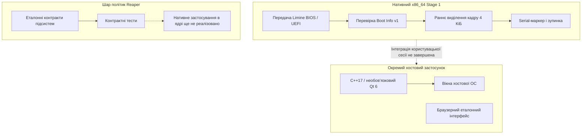

# DAK — проєкт операційної системи на основі Reaper

[English](README.md) · [Українська](README.uk.md) · [Русский](README.ru.md) · [简体中文](README.zh-CN.md)

> Експериментальна системна основа x86_64: завантаження Stage 1, перевірене в QEMU, контракти політик Reaper та окрема настільна оболонка, що працює в хостовій ОС.

**Специфікація**

| Поле | Поточний запис |
|---|---|
| Репозиторій | [Ivan-VHS/DAK](https://github.com/Ivan-VHS/DAK) |
| Стан проєкту | Експериментальна розробка; основа Stage 1 |
| Версія продукту | Єдину версію випуску DAK не оголошено |
| Ціль завантаження | x86_64; збірка образу на Linux; BIOS/UEFI через Limine |
| Мова політик | Reaper; еталонні контракти, нативне застосування не завершене |
| Завантажувальний міст | Вузька freestanding-межа на C11 |
| Хостова оболонка | C++17 / необов’язковий Qt 6 Widgets 6.4+ |
| Інструменти | CMake 3.21+, Python 3.10+, Node.js 22+ |
| Ліцензія | Кореневий LICENSE відсутній; умови поширення не оголошено |
| Перевірка документації | 2026-11-26 |

<p align="center"></p>

## Зміст

- [Призначення та межі](#призначення-та-межі-проєкту)
- [Архітектура](#архітектура-та-потік-даних)
- [Стан реалізації](#стан-реалізації)
- [Збірка та перевірка](#збірка-та-перевірка)
- [Інтерфейси й екосистема](#інтерфейси-й-екосистема)
- [Обмеження та межі довіри](#обмеження-та-межі-довіри)
- [Документація](#документація-та-керування)
- [Історія та ліцензування](#історія-та-ліцензування)

## Призначення та межі проєкту

DAK — експериментальний проєкт операційної системи з трьома окремими середовищами виконання: freestanding-основою ядра x86_64 Stage 1, еталонними контрактами політик Reaper та прототипом настільного застосунку, який працює в хостовій ОС. Наразі це ще не єдина інтегрована користувацька сесія ОС.

Поточний шлях завантаження перевіряє передачу керування від прошивки та Boot Info v1, виділяє й очищує один ранній фізичний кадр розміром 4 КіБ, виводить послідовний маркер і зупиняється. Настільна оболонка працює як застосунок хостової ОС; ядро її не запускає.

## Архітектура та потік даних



Нативний завантажувальний міст навмисно вузький. Reaper відповідає за шар політик та еталонних контрактів; хостові інструменти й супутні застосунки залишаються окремими процесами та репозиторіями, доки ядро не матиме моделі процесів, системних викликів, файлової системи й примусового застосування можливостей.

## Стан реалізації

| Можливість | Зрілість | Межа доказів |
|---|---|---|
| Передача Limine та перевірка Boot Info v1 | Перевірено на Stage 1 | Тести QEMU BIOS і UEFI |
| Раннє виділення фізичного кадру | Реалізовано для Stage 1 | Один кадр 4 КіБ; без звільнення |
| IDT винятків CPU | Частково / маркер QEMU перевірено | Вектори 0–31; маршрутизацію IRQ не завершено |
| Політики підсистем Reaper | Реалізовано як еталонні контракти | Тести не означають застосування ядром |
| Хостова нативна оболонка | Частково | Qt-застосунок з вікнами хостової ОС |
| Браузерний прототип | Еталонна реалізація | Не є нативним композитором |
| Процеси, ABI системних викликів, віртуальна пам’ять | Заплановано | Користувацької сесії ядра немає |
| Файлова система, супервізор служб, менеджер пакунків, інсталятор | Заплановано | Життєвий цикл служб ядра відсутній |
| Runtime драйверів, GPU-композитор, аудіостек | Заплановано | Керування фізичними пристроями відсутнє |

Основний реєстр можливостей — [Implementation Status](docs/IMPLEMENTATION_STATUS.md). [Сходи еволюції проєкту](docs/PROJECT_EVOLUTION_LADDER.md) визначають критерії доказів; назви етапів не є сертифікацією випуску.

## Збірка та перевірка

### Контрактні тести хостового середовища

Потрібні CMake 3.21+ і компілятор C11.

```sh
cmake -S . -B build -DCMAKE_BUILD_TYPE=Debug -DBUILD_TESTING=ON
cmake --build build --parallel
ctest --test-dir build --output-on-failure
```

### Завантажувальний образ Stage 1

Збирайте на Linux x86_64. Потрібні GCC/binutils, Git, curl, tar, xorriso та sha256sum:

```sh
boot/build-iso.sh --work-dir build/dak-boot --output dist/DAK-Stage1-x86_64.iso
```

Перевірки QEMU BIOS/UEFI та вимоги до serial-логів описані в [Завантажувальному образі](docs/BOOTABLE_IMAGE.md). Успішне завантаження Stage 1 не означає наявності придатної до роботи сесії ОС.

### Необов’язкова настільна оболонка та браузерний прототип

Для хостової оболонки Qt 6 потрібні компілятор C++17 та Qt 6 Widgets 6.4 або новіший:

```sh
cmake -S . -B build/desktop -DDAK_BUILD_NATIVE_DESKTOP=ON
cmake --build build/desktop --parallel
```

Браузерний еталонний інтерфейс має окремий набір тестів Node:

```sh
npm test
```

Поточний package manifest вказує Node.js 18+, а актуальні інструкції для контриб’юторів і CI використовують Node.js 22+. Ці хостові команди не завантажують ядро в настільну сесію.

## Інтерфейси й екосистема

- [Boot Info v1](docs/BOOT_INFO_V1.md) — дані передачі керування від прошивки та межі їх перевірки.
- [Core subsystem MVP](docs/CORE_MVP_V1.md) — еталонні контракти Reaper і стан нативного застосування.
- [Інтеграція екосистеми](docs/ECOSYSTEM_INTEGRATION.md) — закріплені репозиторії та версійований обмін.
- [Release edition](docs/RELEASE_EDITION.md) — пакування вихідного коду та інструментів; це не встановлюваний випуск ОС.

Суміжні проєкти зберігають власні репозиторії, ліцензії та цикли випуску: [Reaper](https://github.com/Ivan-VHS/Reaper), [Pytyliki](https://github.com/Ivan-VHS/Pytyliki), [OPlague](https://github.com/Ivan-VHS/OPlague) і [VentuSample](https://github.com/Ivan-VHS/VentuSample). Закріплений submodule або хостовий бінарний файл не є інтеграцією з ядром.

## Обмеження та межі довіри

> **Важливо:** DAK ще не є універсальною операційною системою, готовою до встановлення. Після перевірки завантаження та раннього виділення кадру Stage 1 зупиняється.

Таблиці сторінок, повноцінне керування фізичною пам’яттю зі звільненням, ізоляція процесів, диспетчеризація системних викликів, витіснювальне планування, файлова система, супервізор служб, примусове застосування capabilities ядром, промислове завантаження драйверів і нативний композитор не завершені. Нативний компілятор Reaper поки не є freestanding-компілятором ядра.

Операції з обладнанням, прошивкою, драйверами й пакунками не реалізовані або існують лише як еталонні контракти, якщо конкретна перевірена специфікація не стверджує інше. Поле «підпис перевірено», передане викликачем, не є криптографічною перевіркою. SHA-256 виявляє зміну байтів, але не автентифікує видавця.

Станом на 2026-11-26 у корені репозиторію немає LICENSE або SECURITY.md. Не слід припускати права на поширення чи вважати відсутність політики безпеки гарантією безпеки. Див. [CONTRIBUTING](CONTRIBUTING.md) і [контроль документації](docs/DOCUMENTATION_CONTROL.md).

## Документація та керування

Почніть з [індексу документації](docs/README.md) та [інформаційної архітектури](docs/INFORMATION_ARCHITECTURE.md). Реєстр реалізації, посібник із завантаження, архітектура та версійовані схеми є основними технічними джерелами.

- [Архітектура](docs/ARCHITECTURE.md)
- [Стан реалізації](docs/IMPLEMENTATION_STATUS.md)
- [Завантажувальний образ Stage 1](docs/BOOTABLE_IMAGE.md)
- [Контракти збірки](docs/BUILD_CONTRACTS.md)
- [Єдиний стандарт документації](docs/UNIFIED_DOCUMENTATION_STANDARD.md)
- [План актуалізації документації](docs/superpowers/plans/2026-11-26-documentation-rebaseline.md)

## Історія та ліцензування

У репозиторії зафіксовано експериментальну віху завантаження Stage 1 та окрему роботу над хостовою настільною оболонкою. Єдину історію випусків DAK у форматі semantic versioning не оголошено; версії окремих пакетів не можна вважати версіями операційної системи. Точні ревізії вихідного коду та докази збірок фіксуються в реєстрі реалізації й артефактах випусків.

Умови використання стороннього завантажувача та проєктів екосистеми визначаються їхніми upstream-ліцензіями. Конвеєр пакування включає повідомлення про авторські права та закріплені ревізії вихідного коду, але не надає додаткових прав на розповсюдження. Перш ніж оголошувати умови дистрибуції, правовласник має обрати ліцензію кореневого проєкту.
