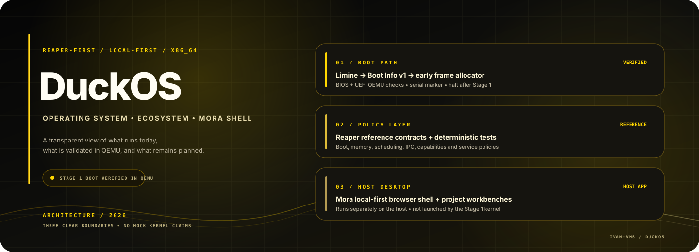

# Duck — проєкт операційної системи з пріоритетом Reaper

[English](README.md) · [Українська](README.uk.md) · [Русский](README.ru.md) · [简体中文](README.zh-CN.md)

  

> Експериментальна системна основа x86_64: завантаження Stage 1, перевірене в QEMU, policy-контракти Reaper та окрема нативна desktop-оболонка хостової ОС.

**Відомості про проєкт:** експериментальна розробка · основа завантаження Stage 1 · x86_64 / Limine BIOS+UEFI · архітектурний напрям Reaper-first · host shell C++17 / необов’язковий Qt 6 Widgets 6.4+ · єдину версію ОС не оголошено · **Документацію перевірено:** 2026-11-27 UTC

## Призначення та межі

Duck — експериментальний проєкт операційної системи, а не готова до встановлення desktop-ОС. Потрібно розрізняти три окремі поверхні виконання:

1. **Ядро Stage 1:** freestanding-основа x86_64, яка перевіряє handoff Limine та Boot Info v1, виконує раннє виділення фізичного кадру, виводить маркер завантаження й зупиняється.
2. **Policy-напрям Reaper:** еталонні контракти підсистем та виконувані policy-тести. Нативне enforcement ядром і freestanding-компілятор/backend Reaper ще не поставляються.
3. **Host desktop:** окремий застосунок C++17 / Qt 6 Widgets, вікнами якого керує хостова операційна система. Ядро Stage 1 його не запускає.

Поточний boot bridge — вузька freestanding-межа на C11. Reaper залишається цільовою першокласною мовою та policy-шаром; успішна перевірка у reference runtime не доводить наявності нативного компілятора, привілеїв ядра або доступу до обладнання.

## Поточний стан реалізації

### Завантаження та основа ядра

- x86_64 Stage 1 використовує закріплений шлях Limine v12.11.1 для BIOS/UEFI та перевіряє Boot Info v1.
- Ранній physical-frame allocator вибирає перевірені доступні ділянки пам’яті, виділяє й очищує один кадр 4 KiB через HHDM, після чого виводить `DUCKOS_BOOT_OK stage=1`.
- Основа обробки винятків містить IDT vectors 0–31, нормалізовані assembly stubs і фатальну діагностику через serial/framebuffer. Maskable interrupts не ввімкнені.
- Структури GDT/TSS/IST для bootstrap і host contract tests наявні; per-CPU setup, запуск додаткових процесорів і повна інтеграція переривань/runtime ще не завершені.
- Reaper надає 40 еталонних контрактів Core Subsystem MVP. Нативне застосування політик ядром очікується.

Завантажувальний образ пройшов перевірки QEMU BIOS та UEFI для Stage 1. Після цього ядро поки зупиняється й не запускає процес або користувацький сеанс.

### Нативна desktop-оболонка хоста

- Необов’язковий застосунок C++17 використовує Qt 6 Widgets 6.4+ і створює справжні top-level вікна, якими керує хостова ОС.
- Локальний каталог слугує для виявлення застосунків; нативний launcher не виконує рядки команд із manifest і не надає апаратних привілеїв.
- Поточні поверхні містять локальне збереження чернеток, перегляд вибраної користувачем папки лише для читання та суто візуальну waveform-панель VentuSample. Вона не відтворює звук і не викликає DSP VentuSample.
- Браузерне preview [`desktop/demo/index.html`](desktop/demo/index.html) — reference-прототип, а не compositor ядра й не реалізація через WebView.

### Шари ОС, що ще не завершені

| Область | Поточна межа |
|---|---|
| Пам’ять | Одне раннє виділення кадру; повторно використовуваний allocator/free і page tables очікуються |
| Переривання | Лише діагностика винятків; зовнішня IRQ-маршрутизація й timer scheduling очікуються |
| Процеси | Модель процесів, Ring 3 та syscall ABI очікуються |
| Безпека | Kernel-enforced capabilities та ізольоване середовище драйверів очікуються |
| Сховище та служби | Filesystem, package manager, init/service supervisor та installer очікуються |
| Графіка й пристрої | Compositor ядра, GPU та audio stack очікуються |

Поки немає повноцінного scheduler, ізоляції процесів, постійного користувацького сеансу, файлової системи, мережевого стека або завантажувача драйверів ядра. Policy-контракти й функції host-застосунку не замінюють ці служби ОС.

## Збирання та перевірка

Нативне збирання розраховане на Linux x86_64. Необов’язкова host desktop-оболонка потребує компілятора C++17 і Qt 6 Widgets 6.4+. Для release image додатково потрібні Git/submodules, CMake, компілятори C/C++, Python 3 як build tooling, Node.js 22, xorriso, curl, tar, QEMU та OVMF.

Збирання нативного desktop за наявності Qt:

~~~sh
cmake -S . -B build/dak-native -DCMAKE_BUILD_TYPE=Release -DDAK_BUILD_NATIVE_DESKTOP=ON
cmake --build build/dak-native --target dak_desktop_native --parallel
ctest --test-dir build/dak-native --output-on-failure
~~~

Запуск браузерного reference preview та його тестів:

~~~sh
./scripts/run-mora.sh
npm test
npm run validate:ecosystem
npm run test:ecosystem
~~~

Запуск preview у Windows PowerShell:

~~~powershell
.\scripts/run-mora.ps1
npm test
~~~

Збирання федеративного Stage 1 release image:

~~~sh
bash boot/build-release-iso.sh --work-dir build/release --output dist/Duck-Stage1-x86_64.iso
~~~

Release pipeline перевіряє закріплені вихідні коди, збирає/тестує host workbenches, пакує вихідні коди й notices та записує SHA-256 checksums. Отриманий ISO — preview вихідного коду й інструментів, а не повноцінна ОС для встановлення. Контрольна сума не є підписом видавця.

## Екосистема та інтерфейси

Репозиторій підключає чотири незалежні upstream-проєкти як submodules. Для ініціалізації використовуйте точно закріплені ревізії:

~~~sh
git submodule update --init --recursive
~~~

- [Reaper](https://github.com/Ivan-VHS/Reaper) — мова, reference runtime і policy-контракти.
- [Pytyliki](https://github.com/Ivan-VHS/Pytyliki) — інвентаризація процесора, обмежені вимірювання та C ABI v1.
- [OPlague](https://github.com/Ivan-VHS/OPlague) — read-only-докази щодо пристроїв/пакетів і версіоновані telemetry snapshots.
- [VentuSample](https://github.com/Ivan-VHS/VentuSample) — offline-генерація аудіо та версіоновані sample packs.

Reaper використовує Pytyliki C ABI v1 лише через явно вказаний шлях до довіреної бібліотеки та перевіряє контракти OPlague snapshot/report для read-only-аналізу. Адаптер policy для нормалізованої GPU telemetry OPlague існує; довірений native JSON ingestion і перевірка provenance видавця/збирання ще очікуються. Споживач VentuSample pack v1 поки лише описаний контрактом. Peer workbenches залишаються user-space проєктами: вони не є kernel modules і не запускаються Stage 1.

## Документація та межі довіри

- [Стан реалізації](docs/IMPLEMENTATION_STATUS.md) · [Індекс документації](docs/README.md)
- [Завантажувальний образ Stage 1](docs/BOOTABLE_IMAGE.md) · [Обробка x86_64 винятків](docs/X86_64_EXCEPTION_HANDLING.md)
- [Контракти Core Subsystem MVP](docs/CORE_MVP_V1.md) · [Інтеграція екосистеми](docs/ECOSYSTEM_INTEGRATION.md)
- [Архітектура desktop](docs/DAK_DESKTOP.md) · [Єдиний стандарт документації](docs/UNIFIED_DOCUMENTATION_STANDARD.md)
- [Сходи зрілості проєкту](docs/PROJECT_EVOLUTION_LADDER.md) · [Інженерна дорожня карта](docs/IMPLEMENTATION_ROADMAP.md)

Не вважайте reference policy, функцію host desktop або ініціалізований submodule нативним enforcement ядра, інтеграцією з ОС чи доступом до обладнання. Підключені проєкти зберігають власну історію, супроводжувачів і upstream-ліцензії. У корені репозиторію наразі немає файла `LICENSE`, тому умови поширення не оголошено; сторонні notices не надають додаткових прав.

---

Duck · репозиторій: Ivan-VHS/DAK · перевірка README 2026-11-27 UTC

