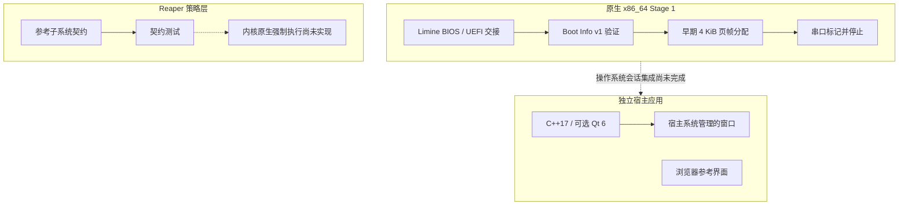

# DAK — 基于 Reaper 的操作系统项目

[English](README.md) · [Українська](README.uk.md) · [Русский](README.ru.md) · [简体中文](README.zh-CN.md)

> 实验性的 x86_64 系统基础：经 QEMU 验证的 Stage 1 启动路径、Reaper 策略契约，以及独立运行于宿主操作系统的桌面外壳。

**规格**

| 字段 | 当前记录 |
|---|---|
| 仓库 | [Ivan-VHS/DAK](https://github.com/Ivan-VHS/DAK) |
| 项目状态 | 实验阶段；Stage 1 基础 |
| 产品版本 | 尚未声明统一的 DAK 发布版本 |
| 原生启动目标 | x86_64；在 Linux 上构建；Limine BIOS/UEFI 镜像 |
| 策略语言 | Reaper；目前为参考契约，内核原生强制执行尚未完成 |
| 启动桥接层 | 精简的 C11 freestanding 平台边界 |
| 宿主桌面 | C++17 / 可选 Qt 6 Widgets 6.4+ |
| 工具链 | CMake 3.21+、Python 3.10+、Node.js 22+ |
| 许可证 | 根目录没有 LICENSE；尚未声明分发条款 |
| 行为准则 | 尚未发布根目录 `CODE_OF_CONDUCT.md` |
| 文档审核日期 | 2026-11-26 |

<p align="center"></p>

## 目录

- [用途与范围](#用途与范围)
- [架构](#架构与数据流)
- [实现状态](#实现状态)
- [构建与验证](#构建与验证)
- [接口与生态](#接口与生态)
- [限制与信任边界](#限制与信任边界)
- [文档与治理](#文档与治理)
- [历史与许可](#历史与许可)

## 用途与范围

DAK 是一个实验性操作系统项目，目前包含三个彼此独立的执行部分：freestanding x86_64 Stage 1 内核基础、Reaper 参考策略契约，以及运行在宿主操作系统中的桌面原型。它们尚未组成一个完整集成的操作系统会话。

当前启动流程验证固件交接和 Boot Info v1，分配并清零一个早期 4 KiB 物理页帧，输出串口标记后停止。桌面外壳作为宿主系统应用运行，不由内核启动。

## 架构与数据流



原生启动桥接层刻意保持精简。Reaper 负责策略与参考契约；在内核具备进程模型、系统调用、文件系统和能力强制执行之前，宿主工具及配套应用仍属于独立进程和独立仓库。

## 实现状态

| 能力 | 成熟度 | 证据边界 |
|---|---|---|
| Limine 交接与 Boot Info v1 验证 | Stage 1 已验证 | QEMU BIOS 和 UEFI 测试 |
| 早期物理页帧分配 | Stage 1 已实现 | 单个 4 KiB 页帧；无释放路径 |
| CPU 异常 IDT | 部分实现 / QEMU 标记已验证 | 向量 0–31；IRQ 路由尚未完成 |
| Reaper 子系统策略 | 参考契约已实现 | 测试不代表内核已强制执行 |
| 宿主原生桌面外壳 | 部分实现 | Qt 应用；窗口由宿主系统管理 |
| 浏览器桌面预览 | 参考实现 | 不是原生合成器 |
| 进程模型、系统调用 ABI、虚拟内存 | 计划中 | 尚无内核用户会话 |
| 文件系统、服务管理器、包管理器、安装器 | 计划中 | 尚无内核服务生命周期 |
| 驱动运行时、GPU 合成器、音频栈 | 计划中 | 尚无物理设备控制 |

权威能力清单见 [Implementation Status](docs/IMPLEMENTATION_STATUS.md)。[Project Evolution Ladder](docs/PROJECT_EVOLUTION_LADDER.md) 定义证据门槛；阶段名称不代表发布认证。

## 构建与验证

### 宿主契约测试

需要 CMake 3.21+ 和 C11 编译器。

```sh
cmake -S . -B build -DCMAKE_BUILD_TYPE=Debug -DBUILD_TESTING=ON
cmake --build build --parallel
ctest --test-dir build --output-on-failure
```

### Stage 1 启动镜像

在 Linux x86_64 上构建，并准备 GCC/binutils、Git、curl、tar、xorriso 和 sha256sum：

```sh
boot/build-iso.sh --work-dir build/dak-boot --output dist/DAK-Stage1-x86_64.iso
```

QEMU BIOS/UEFI 验证和串口日志要求见 [Bootable Image](docs/BOOTABLE_IMAGE.md)。Stage 1 成功启动不意味着已经具备可用的操作系统会话。

### 可选宿主桌面与浏览器预览

宿主 Qt 6 桌面需要 C++17 编译器和 Qt 6 Widgets 6.4 或更新版本：

```sh
cmake -S . -B build/desktop -DDAK_BUILD_NATIVE_DESKTOP=ON
cmake --build build/desktop --parallel
```

浏览器参考界面使用独立的 Node 测试集：

```sh
npm test
```

当前 package manifest 声明 Node.js 18+，而维护者指南和 CI 使用 Node.js 22+。这些宿主命令不会将内核启动到桌面会话中。

## 接口与生态

- [Boot Info v1](docs/BOOT_INFO_V1.md) — 固件交接数据及其验证边界。
- [Core subsystem MVP](docs/CORE_MVP_V1.md) — Reaper 参考契约和原生强制执行状态。
- [Ecosystem integration](docs/ECOSYSTEM_INTEGRATION.md) — 固定版本的伙伴仓库及版本化交换接口。
- [Release edition](docs/RELEASE_EDITION.md) — 源码与工具打包边界；不是可安装的操作系统发行版。

相关项目保持独立仓库、许可证和发布周期：[Reaper](https://github.com/Ivan-VHS/Reaper)、[Pytyliki](https://github.com/Ivan-VHS/Pytyliki)、[OPlague](https://github.com/Ivan-VHS/OPlague) 和 [VentuSample](https://github.com/Ivan-VHS/VentuSample)。子模块固定版本或宿主二进制文件不等于内核集成。

## 限制与信任边界

> **重要：** DAK 目前还不是通用的可安装操作系统。Stage 1 在启动验证和早期页帧分配后停止。

页表、可复用的内存管理、进程隔离、系统调用分发、抢占式调度、文件系统、服务管理器、内核能力强制执行、生产级驱动加载和原生合成器均未完成。当前 Reaper 原生编译器还不能作为 freestanding 内核编译器使用。

除非某个经过验证的具体契约另有说明，对硬件、固件、驱动和软件包的操作尚未实现或仅存在于参考契约中。调用方提供的“签名已验证”字段不是密码学验证。SHA-256 校验和可以检测字节变化，但不能认证发布者。

截至 2026-11-26，仓库根目录没有 LICENSE 或 SECURITY.md。不要假定存在再分发权，也不要把缺少安全策略视为安全保证。请参阅 [CONTRIBUTING](CONTRIBUTING.md) 和 [Documentation Control](docs/DOCUMENTATION_CONTROL.md)。

## 文档与治理

请从[文档索引](docs/README.md)和[信息架构图](docs/INFORMATION_ARCHITECTURE.md)开始。实现状态清单、启动指南、架构和版本化 schema 是主要技术依据。

- [Architecture](docs/ARCHITECTURE.md)
- [Implementation status](docs/IMPLEMENTATION_STATUS.md)
- [Bootable Stage 1 image](docs/BOOTABLE_IMAGE.md)
- [Build contracts](docs/BUILD_CONTRACTS.md)
- [Unified documentation standard](docs/UNIFIED_DOCUMENTATION_STANDARD.md)
- [Documentation rebaseline plan](docs/superpowers/plans/2026-11-26-documentation-rebaseline.md)

## 历史与许可

仓库记录了实验性 Stage 1 启动里程碑，以及独立的宿主桌面开发工作。DAK 尚未声明统一的 semantic-versioning 发布历史；组件包版本不能视为操作系统发行版本。确切源码修订和构建证据应记录在实现清单及发布制品中。

第三方引导程序和生态项目的条款由各自上游许可证管理。打包流程包含版权通知和固定源码修订，但不会授予额外的分发权。在声明分发条款之前，权利持有人必须为根项目选择许可证。
