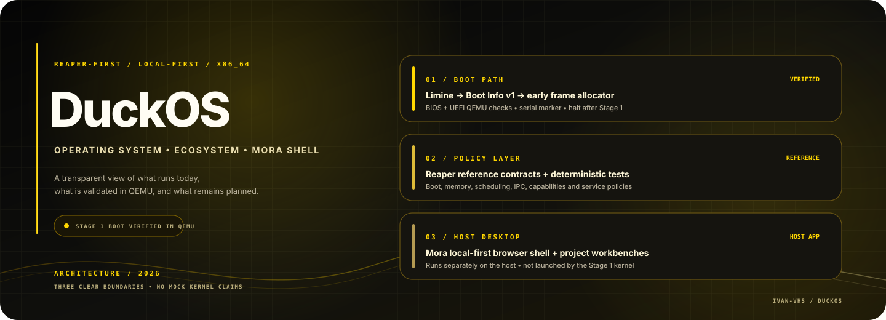

# Duck — 以 Reaper 为核心的操作系统项目

[English](README.md) · [Українська](README.uk.md) · [Русский](README.ru.md) · [简体中文](README.zh-CN.md)

  

> 实验性的 x86_64 系统基础：经 QEMU 验证的 Stage 1 启动路径、Reaper 策略契约，以及独立运行于宿主操作系统的原生桌面外壳。

**项目记录：** 实验阶段 · Stage 1 启动基础 · x86_64 / Limine BIOS+UEFI · Reaper-first 架构方向 · 宿主桌面 C++17 / 可选 Qt 6 Widgets 6.4+ · 尚未声明统一 OS 发行版本 · **文档审核：** 2026-11-27 UTC

## 项目用途与范围

Duck 是一个实验性操作系统项目，目前还不是完整、可安装的桌面操作系统。必须区分以下三个独立的执行部分：

1. **Kernel Stage 1：** freestanding x86_64 启动基础，验证 Limine handoff 和 Boot Info v1，执行早期物理页帧分配，输出启动标记后停止。
2. **Reaper 策略路线：** 参考子系统契约和可执行策略测试。内核原生强制执行以及 freestanding Reaper 编译器/backend 尚未交付。
3. **宿主桌面：** 独立的 C++17 / Qt 6 Widgets 应用程序，其窗口由宿主操作系统管理。Stage 1 内核不会启动它。

当前启动桥接层是精简的 C11 freestanding 平台边界。Reaper 仍是目标中的一等语言和策略层；参考运行时测试通过，并不证明原生编译器、内核权限或硬件访问已经实现。

## 当前实现

### 启动与内核基础

- x86_64 Stage 1 使用固定版本 Limine v12.11.1 的 BIOS/UEFI 路径，并验证 Boot Info v1。
- 早期 physical-frame allocator 从已验证的可用内存区域中分配并通过 HHDM 清零一个 4 KiB 页帧，随后输出 `DUCKOS_BOOT_OK stage=1`。
- 异常处理基础包括 IDT vectors 0–31、规范化 assembly stubs，以及 serial/framebuffer 致命诊断路径。尚未启用 maskable interrupts。
- 已有 GDT/TSS/IST bootstrap 结构和宿主端契约测试；per-CPU 配置、额外处理器启动及完整中断/runtime 集成仍未完成。
- Reaper 提供 40 个 Core Subsystem MVP 参考契约。内核原生策略强制执行仍待实现。

Stage 1 启动镜像已通过 QEMU BIOS 与 UEFI 检查。此后内核仍会停止，不会启动进程或用户会话。

### 宿主原生桌面

- 可选的 C++17 应用使用 Qt 6 Widgets 6.4+，创建由宿主操作系统管理的真实顶层窗口。
- 本地目录用于发现应用；原生 launcher 不执行 manifest 中的命令字符串，也不授予设备权限。
- 当前界面包括本地草稿保存、用户选择的只读文件夹浏览，以及仅用于显示的 VentuSample 波形面板。该面板不会播放音频或调用 VentuSample DSP。
- [`desktop/demo/index.html`](desktop/demo/index.html) 是浏览器参考原型，不是内核 compositor，也不是基于 WebView 的实现。

### 尚未完成的操作系统层

| 领域 | 当前边界 |
|---|---|
| 内存 | 只有一次早期页帧分配；可复用 allocator/free 路径和 page tables 尚未完成 |
| 中断 | 仅有异常诊断；外部 IRQ 路由与定时器调度尚未完成 |
| 进程 | 进程模型、Ring 3 执行和 syscall ABI 尚未完成 |
| 安全 | 内核强制 capabilities 和隔离驱动运行时尚未完成 |
| 存储与服务 | Filesystem、package manager、init/service supervisor 和 installer 尚未完成 |
| 图形与设备 | 内核 compositor、GPU 和音频栈尚未完成 |

目前没有完整 scheduler、进程隔离、持久用户会话、文件系统、网络栈或内核驱动加载器。策略契约与宿主应用功能不能替代这些操作系统服务。

## 构建与验证

原生构建面向 Linux x86_64。可选宿主桌面需要 C++17 编译器和 Qt 6 Widgets 6.4+。发行镜像流程还需要 Git/submodules、CMake、C/C++ 编译器、Python 3 构建工具、Node.js 22、xorriso、curl、tar、QEMU 和 OVMF。

在具备 Qt 时构建原生桌面：

~~~sh
cmake -S . -B build/dak-native -DCMAKE_BUILD_TYPE=Release -DDAK_BUILD_NATIVE_DESKTOP=ON
cmake --build build/dak-native --target dak_desktop_native --parallel
ctest --test-dir build/dak-native --output-on-failure
~~~

运行浏览器参考预览及其测试：

~~~sh
./scripts/run-mora.sh
npm test
npm run validate:ecosystem
npm run test:ecosystem
~~~

Windows PowerShell 预览启动器：

~~~powershell
.\scripts/run-mora.ps1
npm test
~~~

构建联邦 Stage 1 发布镜像：

~~~sh
bash boot/build-release-iso.sh --work-dir build/release --output dist/Duck-Stage1-x86_64.iso
~~~

发布流程会验证固定源码版本、构建/测试宿主工作台、打包源码与 notices，并记录 SHA-256 校验和。生成的 ISO 是源码和工具预览，不是完整可安装的操作系统。校验和不是发布者签名。

## 生态与接口

仓库通过 submodules 引入四个独立上游项目。初始化时使用精确固定的源码版本：

~~~sh
git submodule update --init --recursive
~~~

- [Reaper](https://github.com/Ivan-VHS/Reaper) — 语言、参考运行时和策略契约。
- [Pytyliki](https://github.com/Ivan-VHS/Pytyliki) — 处理器盘点、有界测量和 C ABI v1。
- [OPlague](https://github.com/Ivan-VHS/OPlague) — 只读设备/软件包证据和版本化遥测快照。
- [VentuSample](https://github.com/Ivan-VHS/VentuSample) — 离线音频生成和版本化采样包。

Reaper 仅通过显式指定的可信库路径使用 Pytyliki C ABI v1，并验证 OPlague snapshot/report 契约以进行只读分析。面向规范化 OPlague GPU telemetry 的策略适配器已经存在；可信 native JSON ingestion 以及发布者/构建来源验证仍待完成。VentuSample pack v1 消费端目前仅有契约说明。Peer workbench 均属于 user-space 项目，不是内核模块，也无法由 Stage 1 启动。

## 文档与信任边界

- [实现状态](docs/IMPLEMENTATION_STATUS.md) · [文档索引](docs/README.md)
- [Stage 1 启动镜像](docs/BOOTABLE_IMAGE.md) · [x86_64 异常处理](docs/X86_64_EXCEPTION_HANDLING.md)
- [Core Subsystem MVP 契约](docs/CORE_MVP_V1.md) · [生态集成](docs/ECOSYSTEM_INTEGRATION.md)
- [桌面架构](docs/DAK_DESKTOP.md) · [统一文档标准](docs/UNIFIED_DOCUMENTATION_STANDARD.md)
- [项目成熟度阶梯](docs/PROJECT_EVOLUTION_LADDER.md) · [工程路线图](docs/IMPLEMENTATION_ROADMAP.md)

不要把参考策略、宿主桌面功能或已初始化的 submodule 当作内核原生强制执行、操作系统集成或硬件访问。接入项目保留各自的历史、维护者和上游许可证。当前仓库根目录没有 `LICENSE` 文件，因此尚未声明分发条款；第三方 notices 不会授予额外权利。

---

Duck · repository: Ivan-VHS/DAK · README review 2026-11-27 UTC

