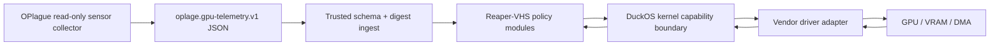

# Reaper-VHS GPU resource and thermal protocol v1

Updated: 2026-11-25

## Scope

Reaper-VHS is a Reaper-language policy layer for GPU memory admission, resource deduplication, migration, telemetry and safe performance profiles. It is designed for DuckOS's primary Intel/AMD x86_64 path while retaining the OS's separate architecture abstraction. GPU vendors are described by a capability ABI; a policy descriptor does not claim that a vendor driver has shipped.

This version implements deterministic, bounded Reaper contracts and their tests. It is not a ring-0 GPU driver, a Vulkan implementation, a hardware memory compressor or an automatic overclocking utility.

## Data path



OPlague v1 currently exports NVIDIA `nvidia-smi` metrics only. It reports unknown fields as null. The Reaper bridge consumes parsed, validated data and stamps a local monotonic timestamp at ingestion; wall-clock UTC is never treated as a monotonic time source.

## Reaper modules

| Module | Implemented policy |
|---|---|
| `duckos/gpu/abi.rpr` | NVIDIA/AMD/Intel descriptor shape, x86_64 ABI match, kernel-verified driver trust, explicit GPU contexts, QoS and capability subsets |
| `duckos/gpu/memory.rpr` | VRAM, host RAM, compressed host RAM and swap budgets; bounded commit admission, tier selection, accounting and release |
| `duckos/gpu/vhs_codec.rpr` | Lossless zero, constant, RLE and raw block encodings; malformed-block rejection and expected SHA-256 digest handoff |
| `duckos/gpu/dedup.rpr` | Same-domain immutable-page sharing, byte-for-byte collision confirmation, reference counts and copy-on-write policy |
| `duckos/gpu/hyperswap.rpr` | Cold-page eviction, pin/critical/dirty guards, demand reload, bounded prefetch advice and IOMMU-gated DMA admission |
| `duckos/gpu/governor.rpr` | Bounded thermal telemetry, stale-sensor/error fallback, temperature-slope prediction and OEM-envelope profile requests |
| `duckos/gpu/security.rpr` | Per-context DMA grants, IOMMU requirement, bounded-shader metadata, integrity/quarantine outcomes and recovery policy |
| `duckos/gpu/oplage_bridge.rpr` | OPlague v1 record validation and sensor conversion without inventing missing readings |

The Reaper source suite is `gpu_vhs_tests.rpr`. CI checks every new `.rpr` module and runs this suite in both the tree-walk runtime and VM.

## Virtual GPU memory model

The pool explicitly accounts for four backing tiers:

1. Physical VRAM after firmware/driver reservations.
2. Raw host RAM staging pages.
3. Compressed host RAM pages.
4. Swap-backed pages.

A virtual commitment is admitted only when the configured commit budget and the backing tiers both have room. A pool may report logical commitment above usable physical VRAM, but it never relabels host RAM or disk as physical VRAM. The additional capacity has different bandwidth and latency and can reduce frame rate when pages migrate frequently.

### VHS Codec v1

The first Reaper codec is deliberately small and lossless:
- `zero`: no data payload;
- `constant`: one repeated byte;
- `rle`: bounded byte-run pairs when payload is below the 80% threshold;
- `raw`: unchanged data when RLE is not beneficial.

Blocks are limited to 4096 bytes. The format carries the expected SHA-256 digest, but the Reaper policy does not pretend to calculate cryptographic hashes itself. A trusted native crypto provider must compute the digest of the original and decoded byte stream; a mismatch quarantines the resource.

VHS Codec v1 is not LZ4, Zstandard, BCn texture compression, or a hardware GPU codec. Those are separate codec backends that can be added after their dependencies, formats and bounded decoders are verified.

## Deduplication and security

Deduplication is deliberately not global across all processes:
- entries must share the same security domain and resource kind;
- resources must be immutable, unpinned and in a shareable residency state;
- a SHA-256 match is only an index candidate; exact byte equality is required;
- a shared page becomes private through copy-on-write before any mutation.

Secret, writable or pinned pages are not deduplicated. The native kernel and driver must still enforce process address spaces, IOMMU domains, page pinning, DMA lifetime and revocation. A passing Reaper policy test does not enforce those properties by itself.

## HyperSwap

Reaper marks pages as migration candidates only after an access-age threshold. Pinned, render-critical and dirty pages remain resident; dirty pages require writeback before eviction. A page fault selects the correct path for raw host RAM, compressed RAM or swap.

DMA migration is permitted by policy only when the native backend reports both pinned buffers and an isolated IOMMU mapping. The driver owns transfer completion, fences, queue quiescence, cache coherency and restoration of the GPU context. Reaper does not suspend a shader and resume arbitrary instructions after a fault; that requires explicit support from a GPU virtualization architecture or driver.

Prefetch is deterministic and advisory. It is bounded by a byte budget and a predicted-use window; no neural predictor is trained or run in this version.

## Frequency and thermal safety

The governor uses integer tenths-of-a-degree Celsius and monotonic sample times. Soft, critical and recovery limits must be supplied from a verified device/board profile; there is no universal safe temperature in this module.

The governor returns only:
- hold the current OEM state;
- request an OEM balanced state;
- request the OEM emergency/safe state;
- allow the vendor driver's default boost inside its stock envelope;
- fail-safe hold when sensors are unavailable or stale.

A performance profile must stay inside driver-reported maximum clock and power limits and require operator approval. DuckOS/Reaper does not write GPU registers, set voltage, force clock tables, modify BIOS settings or bypass vendor power/thermal limits. Emergency response latency depends on the driver and firmware and is not guaranteed to be nanoseconds. Hardware thermal protection remains authoritative.

The policy uses a deterministic temperature-slope forecast, not an AI model. Local learning can be considered later only with bounded, validated samples and without granting the model authority to exceed OEM limits.

## OPlague telemetry contract

OPlague exports `oplage.gpu-telemetry.v1` using:

```sh
python -m tools.gpu_telemetry_export --output dist/gpu-telemetry.json
```

The JSON Schema is maintained in OPlague at `schemas/oplage.gpu-telemetry.v1.schema.json`. The file contains an explicit provider, capture time, sensor values, a canonical payload digest and `controls_performed: false`. SHA-256 protects the content against accidental changes when recalculated by the receiver; it is not a digital signature or publisher authentication.

The first collector is NVIDIA-only. AMD and Intel telemetry need their own verified read-only provider adapters before those metrics can be represented as available.

## Explicit non-goals and remaining native work

This version does not:
- hook `malloc`, CUDA or OpenCL calls globally or inject into applications;
- double physical VRAM, promise a 2x workload or guarantee unchanged FPS;
- implement a GPU hardware driver for NVIDIA, AMD or Intel;
- implement LZ4/Zstd or hardware texture compression;
- map IOMMU tables, pin physical memory, submit PCIe DMA, maintain TLB/cache coherence or recover a real GPU context;
- sign/verify a vendor driver package or load a kernel module;
- perform voltage changes, forced overclocking, undervolting, fan control or register writes;
- implement an AI predictor or automatic 24-hour hardware qualification.

Those features require a kernel-enforced process model, memory manager, PCI/ACPI discovery, IOMMU and DMA backend, signed driver framework, vendor-supported interfaces, native shader validation and hardware-specific thermal limits. They must be added behind the current ABI without weakening the fail-closed policy.

## Verification

`gpu_vhs_tests.rpr` covers:
- memory tier accounting and overcommit bounds;
- zero/constant/RLE/raw round trips and malformed data rejection;
- exact-byte deduplication, domain isolation, reference counts and COW;
- HyperSwap aging, dirty/pinned guards, transfer budgets and integrity failure;
- thermal prediction, stale data, device errors and OEM envelope checks;
- DMA/IOMMU admission, shader metadata and driver recovery;
- OPlague record validation and monotonic timestamp conversion.

A successful Reaper test proves reference-runtime policy correctness only. It does not prove GPU hardware access, physical VRAM migration, compression speed, driver reliability or performance improvement.
